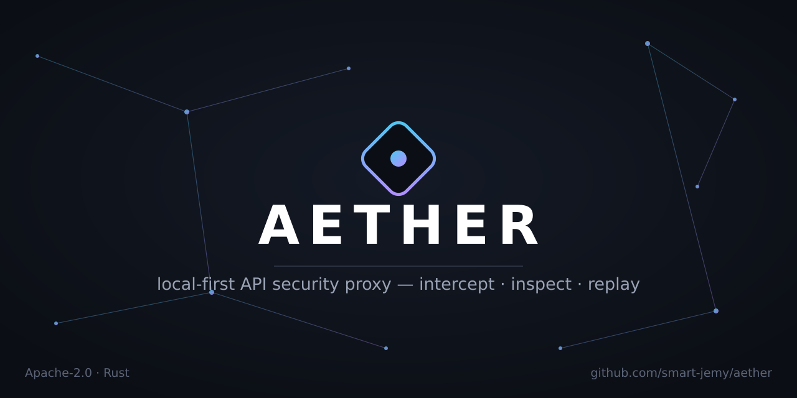
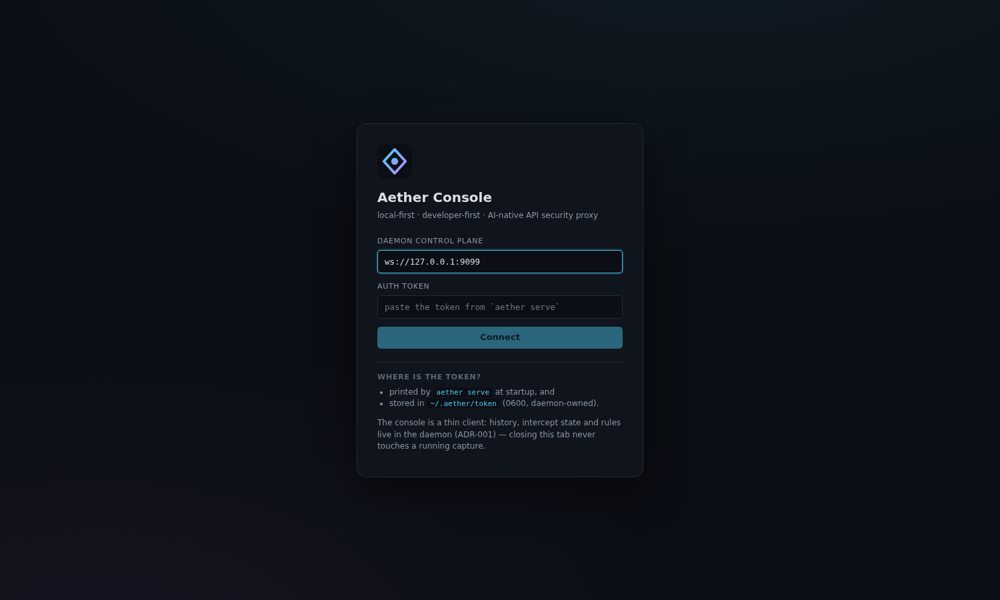
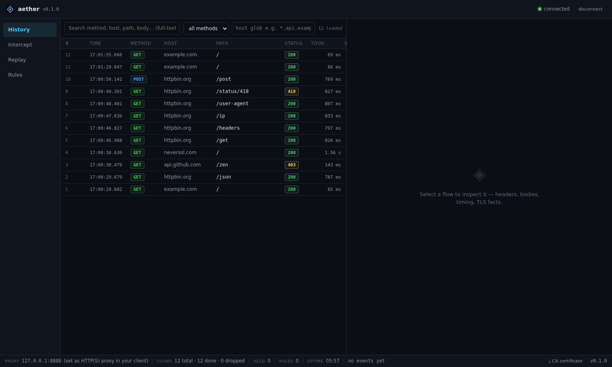
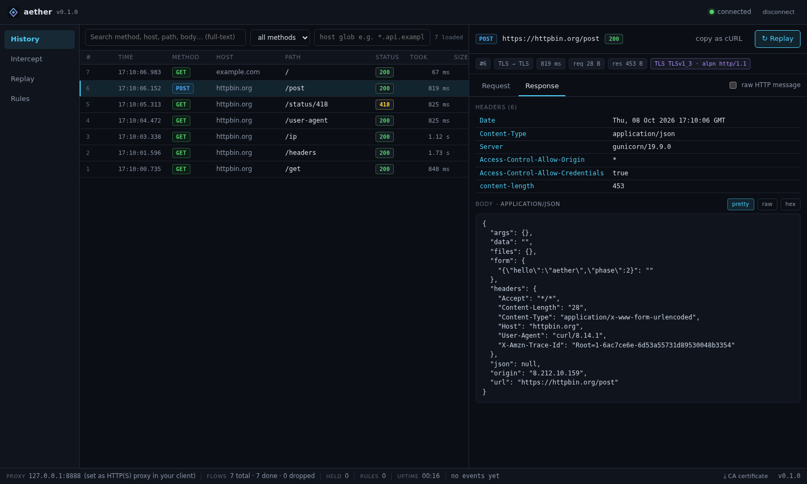
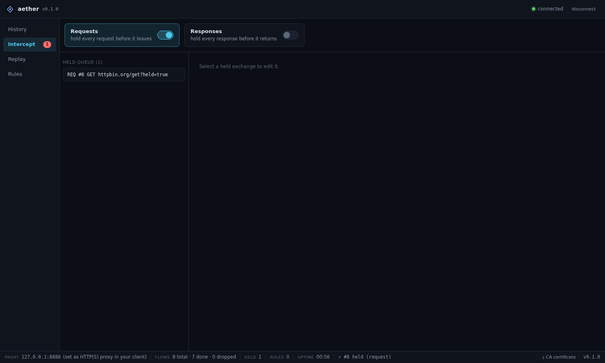
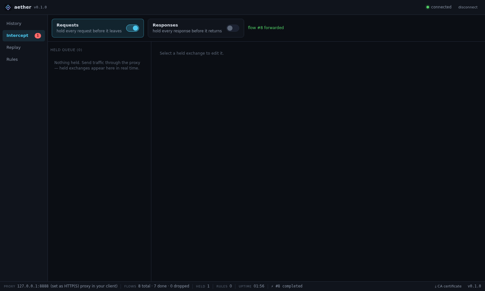
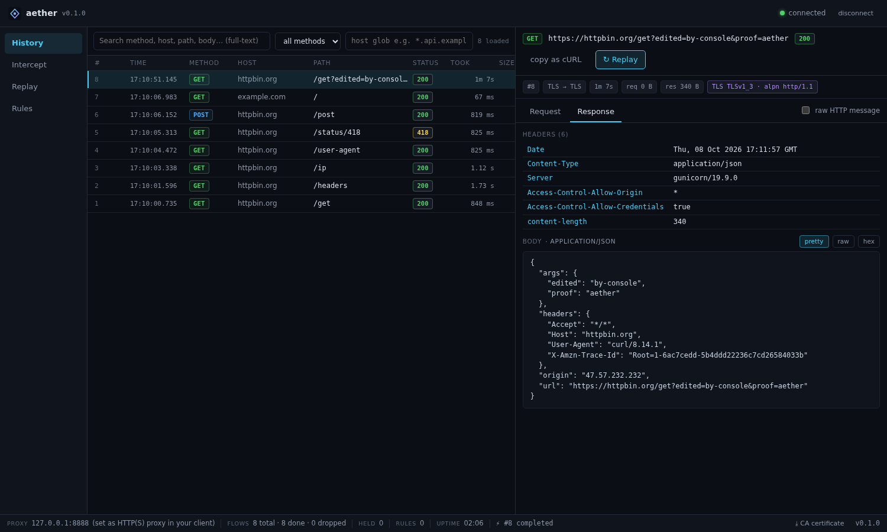
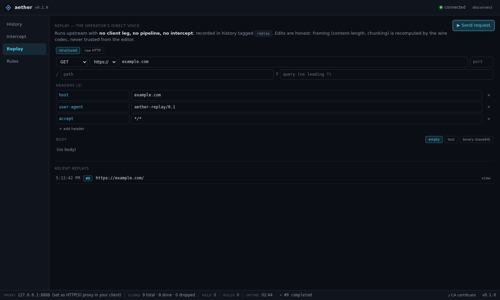
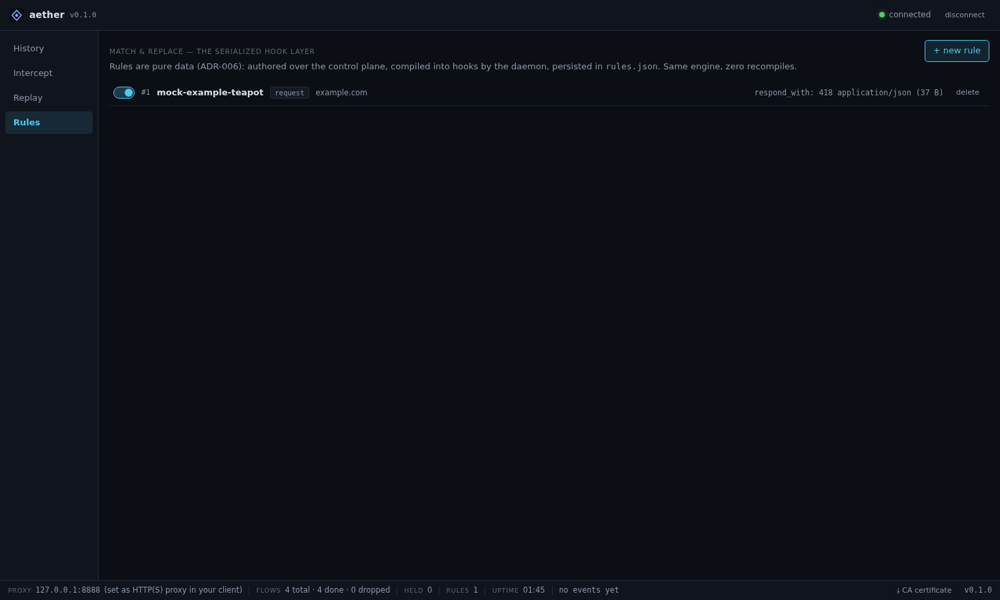
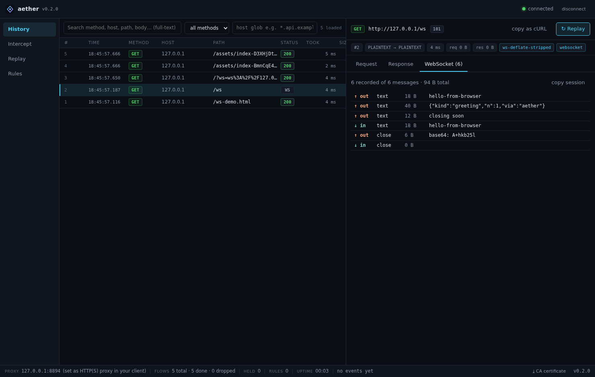

# Aether

<p align="center"></p>

[](https://github.com/T9-source/aether/releases)
[](https://scorecard.dev/viewer.svg?url=github.com/T9-source/aether)
[](https://github.com/T9-source/aether/actions/workflows/ci.yml)
[](https://github.com/T9-source/aether/actions/workflows/codeql.yml)
[](LICENSE)

**The API proxy built like a database, not a desktop app.**

Aether is a **local-first, open-source, developer-first API security proxy**:
intercept, inspect, replay and rewrite HTTP/1 · HTTP/2 · WebSocket traffic —
every flow lands in **local SQLite your AI can search over MCP**. Zero
telemetry, ever.

**Who it's for:** developers and security engineers who found Burp overkill
and mitmproxy terminal-hostile — Burp-style intercept & replay with a modern
console, backed by unbounded local history and reproducible, CI-gated
performance numbers.

---

## Why not mitmproxy / Burp / Caido?

| Capability | Aether 0.2 | mitmproxy 12 | Burp 2026 | Caido |
|---|---|---|---|---|
| Flows on disk (SQLite), unbounded history | ✅ | ❌ (RAM — [mitmproxy#2175](https://github.com/mitmproxy/mitmproxy/issues/2175), open since 2017) | partial (manual disk projects) | ✅ |
| Published reproducible benchmarks | ✅ CI-gated | ❌ | ❌ | ❌ |
| MCP server for local AI clients | ✅ read-only by default | ❌ | ❌ (cloud AI) | ❌ |
| HTTP/1 + HTTP/2 + WebSocket inspection | ✅ | ✅ | ✅ | ✅ |
| Fuzz-tested wire parsers | ✅ CI-gated | ✅ | n/a (closed) | n/a (closed) |
| Open source (Apache-2.0 / MIT) | ✅ | ✅ (MIT) | ❌ | ❌ |
| Zero telemetry | ✅ | ✅ | ❌ | ❌ |

*Every ❌ claimed about a competitor is sourced and dated — full
vendor-linked comparison with the receipts:
[`docs/comparison.md`](docs/comparison.md).*

---

## Install

**Release binaries** (from [Releases](https://github.com/T9-source/aether/releases), sha256 checksums included):

| Target | File |
|---|---|
| Linux x86_64 (static musl) | `aether-x86_64-unknown-linux-musl` |
| macOS Apple Silicon | `aether-aarch64-apple-darwin` |
| macOS Intel | `aether-x86_64-apple-darwin` |
| Windows x86_64 (MSVC) | `aether-x86_64-pc-windows-msvc.exe` |

**From source:**

```bash
git clone https://github.com/T9-source/aether && cd aether
cargo build --release -p aether-cli   # first build takes a few minutes
```

---

## The console, in screenshots

Real captures of the live UI — no mockups.

**Connect** — one screen between you and the daemon:

<p align="center"></p>

**Live history** — virtualized, full-text searchable, every status at a glance:

<p align="center"></p>

**Flow viewer** — headers, pretty/raw/hex bodies, TLS facts, copy-as-cURL:

<p align="center"></p>

**Intercept** — hold a request before it leaves, edit, then forward or drop:

<p align="center"></p>

*The same flow after forwarding — tagged, never a silent drop:*

<p align="center"></p>

**Structured editing that reaches the wire** — the edited query string is what httpbin echoes back:

<p align="center"></p>

**Replay** — structured or raw HTTP; framing recomputed by the wire codec, never trusted from the editor:

<p align="center"></p>

**Match & replace rules** — pure JSON (ADR-006), live over the control plane, no recompiles:

<p align="center"></p>

**WebSocket inspection** — direction, kind, size, preview; recorded sessions live on the flow:

<p align="center"></p>

---

## Quickstart (first run)

```bash
# 1) start the daemon (history in RAM for a first look)
cargo run -p aether-cli -- serve --memory

# 2) export & install the CA once (browser → import as trusted root CA)
cargo run -p aether-cli -- ca export --out aether-ca.pem

# 3) point any client at the proxy and browse https://…
curl -x http://127.0.0.1:8888 --cacert aether-ca.pem https://example.com/

# 4) watch history from a second terminal
aether flows list
aether flows show 1
```

> **MCP note:** Aether is *not* an "MCP gateway" (a proxy that sits in front
> of MCP servers). It's the inverse — a traffic proxy that **exposes an MCP
> server** so your AI can query the traffic it captured.

### The console

```bash
# serve the console UI, then open http://localhost:5173 in a browser
cd apps/aether-ui && npm install && npm run dev
# → connect with:  ws://127.0.0.1:9099  + the token printed by `aether serve`
```

In the console: live history (virtualized), full request/response viewer
(pretty JSON / raw / hex, TLS facts, copy-as-cURL), intercept hold→edit→
forward/drop with structured editors, one-click replay of any request
(plus a dedicated replay editor), and live match & replace rules with
mock/rewrite/tag actions — all driving the same daemon the CLI talks to.
V0.2 adds an **HTTP/2** chip + `alpn` fact per flow and a **WebSocket tab**
(direction ↑/↓, kind, size, preview — recorded sessions live on the flow).
A Tauri 2 desktop shell wraps the same UI (`apps/aether-desktop`, built on
desktop machines — see its README).

Manual interception (the Burp-style loop, from the CLI only — no UI needed):

```bash
aether intercept set --request true      # hold new requests
aether intercept ls                      # see held flows
aether intercept show 7                  # dump as JSON
aether intercept release 7 --header "X-Reviewed: yes" --body-file req.json
aether intercept drop 7                  # or kill it (client gets 502)
```

Match & replace rules — pure JSON, live over the control plane (edits hit
in-flight traffic immediately, no daemon restart):

```bash
aether rules add --file examples/rule-stamp-header.json
aether rules ls
```

### The AI layer starts here: MCP server (stdio)

Plug a running daemon into any MCP client (Claude Desktop, VS Code, Cline, …):

```bash
aether mcp                    # read-only: status, flows, search, intercept view, rules
aether mcp --allow-write      # adds intercept set/drop + rules remove
```

Claude Desktop `claude_desktop_config.json`:

```json
{
  "mcpServers": {
    "aether": {
      "command": "/path/to/aether",
      "args": ["mcp"]
    }
  }
}
```

Read-only by default (ADR-008): the AI reads your traffic, it does not touch
it — unless you explicitly hand it the keys. No telemetry, ever.

### Prove it to yourself

```bash
aether bench flows --n 100000
# insert ≈12k/s · list page(50) p50 ≈ 0.5 ms · FTS5 search ≈ 70 ms over 100k

aether bench proxy          # direct vs plain-proxy vs MITM (p50/p95/p99)
aether soak --secs 60       # continuous traffic + RSS/FD sampling (--secs 86400 = the 24h run)
scripts/demo.sh             # the birth moment, reproducible in ~30s, minus secrets
```

Scale and latency claims are **enforced as budgets in CI** against
[`docs/bench/baseline.json`](docs/bench/baseline.json) — a regression fails
the build (methodology in [`docs/PERF.md`](docs/PERF.md)).

Known limits are documented, not hidden: see [`docs/LIMITATIONS.md`](docs/LIMITATIONS.md), and the
honest, evidence-linked [`docs/comparison.md`](docs/comparison.md) (vs mitmproxy / Burp / Caido).

---

## Structure

```
aether/
├── crates/
│   ├── aether-core/          # domain core: traffic model, pipeline, events,
│   │   └── bindings/         #   rules, storage port — zero protocol knowledge
│   ├── aether-http/          # network engine: hand-rolled h1 (wire truth),
│   │                         #   TLS MITM (rustls+rcgen), CA, intercept, engine
│   ├── aether-store-sqlite/  # ADR-005 backend: WAL, keyset pagination, FTS5
│   └── aether-daemon/        # state owner: proxy+storage+control plane wiring
├── apps/
│   ├── aether-cli/           # `aether` — pure WS client of the daemon (ADR-001)
│   ├── aether-ui/            # console: history/viewer/intercept/replay/rules
│   └── aether-desktop/       # Tauri 2 shell around the console (ADR-012)
├── examples/                 # aether.toml + rule files
├── docs/
│   ├── adr/                  # 18 accepted ADRs, all linked to code
│   ├── PHASE-0.md            # primitives: DoD + proof
│   ├── PHASE-1.md            # real proxy: DoD + scale numbers
│   ├── PHASE-2.md            # console UI: DoD + end-to-end proofs
│   ├── AUDIT.md              # line-level security self-audit (findings fixed)
│   ├── PERF.md               # measured latency baselines + regression budgets
│   └── LIMITATIONS.md        # every limit is a decision, not an oversight
└── .github/workflows/        # ci · codeql · scorecard · nightly soak · release
```

## Architecture invariants

1. `aether-core` has **zero infrastructure/protocol dependencies** (ADR-014).
   It knows nothing about TLS / SQLite / WebSocket / Tauri / React / wire
   codecs; its tokio usage is limited to `sync` + `time` primitives.
   Enforced by `scripts/check-core-deps.sh` in CI.
2. GUI, CLI and CI are all just clients of the daemon (ADR-001) — killing the
   UI never touches traffic.
3. Every pipeline stage routes through the `HookRegistry`; match & replace
   ships as serialized `RuleSpec`s → `RuleHook`s — declarative, never a
   scripting language (ADR-006 #1/#2, ADR-016).
4. Every security-relevant state change is an event on the bus, classified
   into one of four categories (ADR-017); drops are *tagged decisions*,
   never silent failures.
5. The proxy owns its bytes: hand-rolled h1 codec, original header order and
   casing preserved on the **observed** wire, with observed-vs-forwarded
   framing recorded as explicit model facts (ADR-009, ADR-015); ambiguous
   framings refused loudly.
6. The daemon is composition only — behavior lives in named services
   (`services/**`), the control plane is a protocol codec that delegates
   (ADR-016).

## Roadmap (frozen ladder — see `docs/adr/README.md`)

| Version | Scope | Status |
|---------|-------|--------|
| V0.1 | Usable MVP: h1 + TLS MITM + history + intercept + replay + rules + SQLite + control plane + console | ✅ shipped (Phases 0–2) |
| — | **V0 dogfoodable**: latency bench, soak harness, demo script, LIMITATIONS doc | ✅ shipped (Phase 3A) |
| V0.2 | Modern Web: **HTTP/2 (ALPN, streams) + WebSocket inspection** | ✅ **shipped (Phase 3B)** — acceptance criteria in ADR-018 |
| — | **V0.2.x stabilization gate**: security audit → fuzzing → soak → perf regression | 🟡 **in progress (Phase 5)** — audit done ([AUDIT](docs/AUDIT.md)), fuzzing green (3 targets, 6M+ execs), soak gate landed (`aether soak --assert-mode`), perf budgets landed ([PERF](docs/PERF.md)); remaining: the 24h soak acceptance run |
| V0.3 | Extensibility: WASM plugin host (Extism), permissions, SDK | gated on the stabilization gate |
| V1.0 | Security platform: query language, tagging, fuzzing, automation, AI layer (BYO-key, off by default) | planned |

## Founder

Built by **T9-source**. Apache-2.0 — see [LICENSE](LICENSE) and
[ADR-008](docs/adr/ADR-008-license-and-business-model.md). Zero telemetry,
ever.
